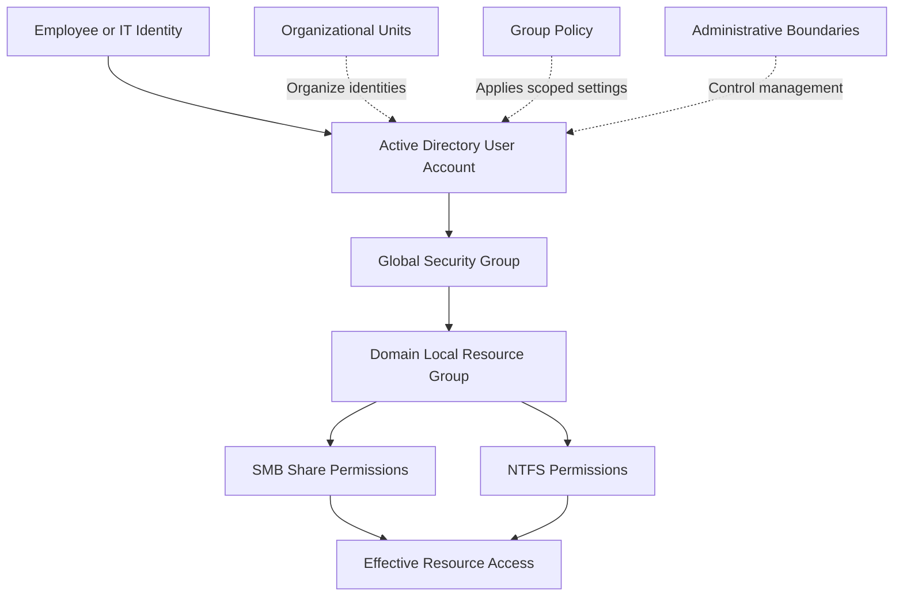
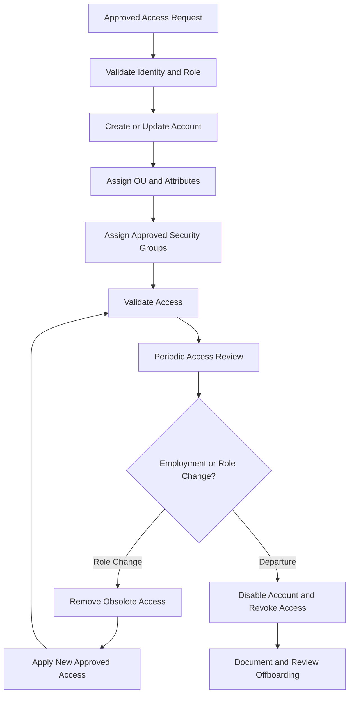

# Enterprise Active Directory Identity & Access Management (IAM)

**Engineering Portfolio Project | Microsoft Active Directory | RBAC | Least Privilege | PowerShell Automation**


> **Project objective:** Design, implement, and validate an enterprise-inspired Active Directory IAM solution that demonstrates practical identity administration, role-based authorization, least-privilege enforcement, identity lifecycle management, and security configuration validation.

**Author:** Zyra  
**Environment:** AWS · Windows Server 2019 Datacenter · Active Directory Domain Services  
**Repository:** `active-directory-iam`

---

## Table of Contents

1. [Executive Summary](#1-executive-summary)
2. [Business Problem](#2-business-problem)
3. [Project Objectives](#3-project-objectives)
4. [Lab Environment](#4-lab-environment)
5. [IAM Architecture](#5-iam-architecture)
6. [Directory and Identity Design](#6-directory-and-identity-design)
7. [Role-Based Access Control](#7-role-based-access-control)
8. [Identity Lifecycle Management](#8-identity-lifecycle-management)
9. [Resource Authorization and Least Privilege](#9-resource-authorization-and-least-privilege)
10. [Authentication and Security Policies](#10-authentication-and-security-policies)
11. [Privileged Access Management](#11-privileged-access-management)
12. [PowerShell Automation](#12-powershell-automation)
13. [Validation and Acceptance Testing](#13-validation-and-acceptance-testing)
14. [Evidence Gallery](#14-evidence-gallery)
15. [Operational Runbooks](#15-operational-runbooks)
16. [Repository Structure](#16-repository-structure)
17. [Security Considerations](#17-security-considerations)
18. [Implementation Status](#18-implementation-status)
19. [Engineering Decisions and Lessons Learned](#19-engineering-decisions-and-lessons-learned)
20. [Future Improvements](#20-future-improvements)

---

## 1. Executive Summary

This project demonstrates the engineering of an Identity and Access Management foundation using Microsoft Active Directory Domain Services (AD DS).

The implementation focuses on the complete identity-to-resource authorization process: organizing directory objects, assigning access through security groups, controlling permissions on shared resources, managing account lifecycles, and validating security policies.

Rather than treating Active Directory as merely a domain-joining service, the project approaches it as an identity infrastructure responsible for supporting authentication, authorization, administrative delegation, and consistent access governance.

The lab uses an existing AWS-hosted Active Directory environment. Existing directory objects and configurations will be inspected before changes are made, allowing the project to demonstrate configuration assessment and controlled remediation as well as implementation.

### Engineering outcomes

The project is intended to demonstrate the ability to:

- Assess an existing Active Directory environment before changing it.
- Design a maintainable organizational unit hierarchy.
- Translate business job roles into security group memberships and resource permissions.
- Implement role-based access control using a documented group-nesting strategy.
- Apply and test least-privilege authorization on SMB and NTFS resources.
- Automate repeatable identity administration with PowerShell.
- Validate identity policies and effective configuration.
- Produce reproducible test cases, operational runbooks, and technical evidence.

### Project evidence

The screenshots and test records in this repository will document actual implementation outcomes. Proposed designs and unverified configurations will not be presented as completed controls.

**Current status:** Initial discovery and architecture validation.

### Project overview evidence


*Figure 1 — Planned evidence: a sanitized overview of the completed lab architecture and major IAM components. Capture this after the relevant components have been implemented and verified.*

---

## 2. Business Problem

Organizations require consistent mechanisms for creating identities, assigning access according to job responsibilities, and removing access when employees change roles or leave.

Without a structured IAM model, organizations may experience:

- Inconsistent account provisioning.
- Unnecessary privileges and excessive group memberships.
- Direct user permissions that are difficult to audit.
- Unclear ownership of shared-resource access.
- Incomplete offboarding and lingering access.
- Inconsistent identity policies across users and computers.
- Limited evidence that security controls work as intended.

These problems affect confidentiality, operational reliability, auditability, and the ability to manage access at scale.

### Proposed solution

The project addresses these risks through a documented Active Directory IAM architecture built around:

1. Structured identity and computer organization.
2. Role-based security group assignment.
3. Resource-specific authorization groups.
4. Least-privilege share and NTFS permissions.
5. Repeatable account lifecycle procedures.
6. Controlled administrative privileges.
7. Evidence-based acceptance testing.

The objective is not simply to configure Active Directory objects. It is to demonstrate why each configuration exists, which requirement it satisfies, and how its effectiveness can be verified.

---

## 3. Project Objectives

| Objective | Intended outcome | Verification method |
|---|---|---|
| Directory architecture | Maintainable OU and naming design | AD PowerShell discovery |
| Identity provisioning | Repeatable account creation and placement | User and attribute inspection |
| Role-based access | Documented group-to-role mappings | Membership queries |
| Least privilege | Restricted access to approved resources | Positive and negative access tests |
| Lifecycle management | Controlled onboarding, transfers, and offboarding | Lifecycle acceptance tests |
| Identity security | Appropriate policies and administrative boundaries | Policy and membership validation |
| Automation | Reusable and guarded PowerShell scripts | Script testing and review |
| Documentation | Reproducible technical project | Repository and evidence review |

The objectives describe intended outcomes. Completion will be recorded only after the corresponding implementation and validation steps have been performed.

---

## 4. Lab Environment

The project builds on the existing lab rather than requiring a complete rebuild.

| Component | Reported configuration |
|---|---|
| Cloud platform | Amazon Web Services |
| Virtual private cloud | `10.0.0.0/16` |
| Primary domain controller | DC01 |
| Private IP | `10.0.1.121` |
| Operating system | Windows Server 2019 Datacenter |
| AD DNS domain | `corp.local` |
| NetBIOS domain | `CORP` |
| Monitoring platform | Wazuh; excluded from the initial IAM scope |

These values reflect the previously reported lab configuration and remain subject to verification during discovery.

### Environment evidence


*Figure 2 — Placeholder: capture the verified domain properties and domain-controller identity. Redact sensitive infrastructure details where appropriate.*


*Figure 3 — Placeholder: show the existing directory structure in Active Directory Users and Computers before making changes.*

**Evidence requirement:** Record the command or administrative view used, the date of validation, and any relevant configuration discrepancy. Do not include passwords, private keys, access tokens, or unnecessary personal information.

---

## 5. IAM Architecture

The architecture separates identity organization, role assignment, resource authorization, and administrative control.

### 5.1 Identity-to-resource access model



### 5.2 Architecture principles

**Identity separation:** Each employee receives an individual account. Shared accounts are avoided for routine user administration.

**Role-based assignment:** Users receive permissions through approved security groups instead of ad hoc individual ACL entries.

**Least privilege:** Users receive only the access necessary for their responsibilities.

**Administrative separation:** Routine IT support is separated from domain-wide administration wherever feasible.

**Controlled lifecycle:** Account creation, modification, disablement, and offboarding follow documented procedures.

**Evidence-based validation:** A configured setting is not considered effective until its actual behavior or resultant configuration has been verified.

### Architecture evidence


*Figure 4 — Placeholder: include a rendered architecture diagram or a sanitized view of the implemented directory and resource-access design.*

---

## 6. Directory and Identity Design

### 6.1 Proposed organizational unit hierarchy

The final structure will be reconciled with the existing directory before implementation.

```text
corp.local
└── OU=Contoso
    ├── OU=Users
    │   ├── OU=IT
    │   ├── OU=Operations
    │   └── OU=Finance
    ├── OU=Groups
    ├── OU=Workstations
    ├── OU=Servers
    └── OU=AdministrativeAccounts
```

This is a proposed logical design, not a claim that these OUs already exist.

### 6.2 Organizational units versus security groups

| Directory object | Primary purpose |
|---|---|
| Organizational unit | Organizes objects and supports Group Policy scope and administrative delegation |
| User account | Represents an individual identity |
| Computer account | Represents a domain-joined computer |
| Global security group | Collects identities with a shared role or organizational responsibility |
| Domain Local security group | Represents access to a particular domain resource |
| Group Policy Object | Applies supported configuration settings within its effective scope |

An OU is not a substitute for an authorization group. Placing a user in an `IT` OU does not automatically grant access to an IT file share.

### 6.3 Naming conventions

| Object | Proposed convention | Example |
|---|---|---|
| Standard user | Organization-defined username | `jane.doe` |
| Global role group | `GG_<Role>` | `GG_IT_Staff` |
| Resource-access group | `DL_<Resource>_<Access>` | `DL_ITShare_Modify` |
| Computer | Role-based hostname | `WS-IT-001` |
| Resource | Descriptive name | `ITShare` |

Naming conventions will be finalized after inspecting the existing environment.

### Directory evidence


*Figure 5 — Placeholder: show the implemented OU hierarchy with the relevant distinguished names verified.*


*Figure 6 — Placeholder: demonstrate a fictional test user's verified group memberships.*

---

## 7. Role-Based Access Control

Role-based access control (RBAC) assigns access based on approved job responsibilities rather than granting permissions independently to each user.

The proposed design uses the AGDLP model:

**Accounts → Global groups → Domain Local groups → Permissions**

### 7.1 Illustrative access matrix

The following is a proposed starting point. Final permissions must be approved against the fictional organization's business requirements and tested in the lab.

| Role | IT shared resource | Operations resource | Finance resource |
|---|---|---|---|
| IT staff | Modify, if approved | No access by default | No access by default |
| Operations staff | No access by default | Modify, if approved | No access by default |
| Finance staff | No access by default | No access by default | Modify, if approved |
| Standard employee | No access by default | No access by default | No access by default |
| Domain administrator | Administrative access subject to role and policy | Administrative access subject to role and policy | Administrative access subject to role and policy |

A domain administrator's technical capability does not justify using that account for routine business access. Administrative activity should use dedicated privileged identities and be kept separate from ordinary workflows.

### 7.2 Group design example

```text
jane.doe
    |
    v
GG_IT_Staff
    |
    v
DL_ITShare_Modify
    |
    v
ITShare permissions
```

This diagram illustrates the proposed design only. It does not establish that these objects or memberships exist in the lab.

### RBAC evidence


*Figure 7 — Placeholder: show verified membership between the relevant global and domain local groups.*


*Figure 8 — Placeholder: show the resource ACL entries that reference the intended resource-access groups.*

---

## 8. Identity Lifecycle Management

Identity management must cover the full employee lifecycle, not just initial account creation.

### 8.1 Lifecycle workflow



### 8.2 Required procedures

- **Onboarding:** Validate the approved request, create the account, assign attributes and groups, and verify access.
- **Role change:** Remove obsolete access before or as part of applying newly approved permissions.
- **Disablement:** Disable access promptly when authorized by the applicable offboarding or security process.
- **Re-enablement:** Require authorization and verify account state and group memberships before restoring access.
- **Offboarding:** Disable the account, revoke access through approved processes, review ownership of business resources, and preserve records according to policy.
- **Deletion:** Delete accounts only when authorized and after retention, ownership, and recovery considerations have been addressed.

### Lifecycle evidence


*Figure 9 — Placeholder: demonstrate the creation of a fictional test identity and verification of its directory attributes.*


*Figure 10 — Placeholder: show the verified account state after disablement. Do not use a screenshot as the sole proof that authentication is denied.*

---

## 9. Resource Authorization and Least Privilege

The project will use an existing shared resource where suitable or a controlled test resource such as `C:\ITShare`, shared as `ITShare`.

Access control must be evaluated at both the SMB share and NTFS layers.

### 9.1 Authorization model

- Share permissions constrain access through the SMB share.
- NTFS permissions govern file-system access.
- Effective network access is constrained by the combined applicable permission checks, including applicable deny entries and group memberships.
- A successful domain logon does not guarantee permission to open a particular resource.

### 9.2 Validation scenarios

| Scenario | Expected result |
|---|---|
| Approved IT user accesses the IT share | Access permitted within the approved rights |
| Unauthorized Operations user accesses the IT share | Access denied |
| User attempts a prohibited write operation | Write denied |
| User loses the relevant resource group membership | Previously granted access is removed after the relevant security state is refreshed |
| Administrator inspects permissions | ACL and effective access can be examined using authorized administrative tools |

These are expected outcomes, not completed test results.

### Resource access evidence


*Figure 11 — Placeholder: capture verified SMB share permissions.*


*Figure 12 — Placeholder: capture verified NTFS ACL entries for the test resource.*


*Figure 13 — Placeholder: show an actual successful access test using the intended domain test account.*


*Figure 14 — Placeholder: show an actual denied-access result for a user who is not authorized for the resource.*

Record the test account's intended role, relevant group memberships, resource path, test time, observed outcome, and any necessary session or credential refresh. Avoid publishing passwords or sensitive personal data.

---

## 10. Authentication and Security Policies

The project will assess relevant Active Directory identity controls, including:

- Password and account-lockout policy.
- Account expiration and lifecycle requirements.
- Administrative account separation.
- Interactive and remote sign-in restrictions where justified.
- Group Policy inheritance and scope.
- Security filtering and delegation.
- DNS and time synchronization dependencies.

Domain-wide account policies and OU-scoped policies must be applied at the appropriate scope. Password policy behavior must be assessed against the domain configuration and any applicable fine-grained password policies.

A linked GPO is not proof that a setting is effective. Validation will include resultant policy information and relevant configuration checks.

### Policy evidence


*Figure 15 — Placeholder: capture the verified domain password and lockout policy settings.*


*Figure 16 — Placeholder: capture verified resultant policy information from the relevant test computer or user.*

---

## 11. Privileged Access Management

The project will distinguish between:

- Standard employee accounts.
- IT support accounts.
- Dedicated domain administration accounts.
- Service accounts, if required.

The design will examine privileged group memberships, unnecessary administrator rights, shared administrative identities, and delegated administrative tasks.

Where practical, a limited administrative operation will be delegated to a suitable account without granting Domain Admin membership.

The project will not claim to implement enterprise privileged access management features that require additional infrastructure or licensing.

### Privileged access evidence


*Figure 17 — Placeholder: show a sanitized review of privileged group membership and documented remediation where applicable.*

---

## 12. PowerShell Automation

PowerShell will be used to make repeatable identity operations safer and easier to audit.

The script library will be developed incrementally and will include appropriate validation and error handling.

| Script category | Intended responsibility |
|---|---|
| `scripts/users/` | Provision, inspect, and manage identities |
| `scripts/groups/` | Create and validate approved group structures |
| `scripts/permissions/` | Inspect and manage resource permissions |
| `scripts/auditing/` | Report group memberships and directory configuration |
| `scripts/validation/` | Validate implementation requirements and policy state |

Scripts will avoid hardcoded secrets, use explicit inputs, and incorporate dry-run or confirmation safeguards for potentially destructive changes.

### Automation evidence


*Figure 18 — Placeholder: capture actual provisioning output and a subsequent query verifying the resulting account state.*


*Figure 19 — Placeholder: show actual validation output, including any detected discrepancies.*

---

## 13. Validation and Acceptance Testing

Acceptance testing will determine whether the implementation meets the documented requirements.

Each test will include:

- Test ID.
- Objective and prerequisites.
- Procedure.
- Expected result.
- Actual result.
- Evidence reference.
- Pass/fail status.
- Remediation where required.

### Initial acceptance-test register

| ID | Test objective | Status |
|---|---|---|
| IAM-001 | Create a user and verify OU placement | Not run |
| IAM-002 | Verify approved role-group memberships | Not run |
| IAM-003 | Verify authorized resource access | Not run |
| IAM-004 | Verify unauthorized access is denied | Not run |
| IAM-005 | Review least privilege and effective permissions | Not run |
| IAM-006 | Disable a test account and verify authentication denial | Not run |
| IAM-007 | Re-enable an account and verify resulting state | Not run |
| IAM-008 | Remove obsolete access after a role change | Not run |
| IAM-009 | Verify relevant Group Policy settings | Not run |
| IAM-010 | Identify unintended direct ACL entries and excessive group memberships | Not run |

Test statuses will be updated only after evidence is collected.

### Test evidence


*Figure 20 — Placeholder: capture the final test report or sanitized validation summary after executing the acceptance tests.*

A test will not be marked as passed solely because a PowerShell command returned without an error. The result must demonstrate the actual requirement being tested.

---

## 14. Evidence Gallery

The evidence directory will contain sanitized screenshots and supporting records that substantiate project claims.

| Evidence ID | Evidence item | Status |
|---|---|---|
| EV-001 | Domain and DC01 configuration | Pending |
| EV-002 | Existing and final OU hierarchy | Pending |
| EV-003 | Verified role-group memberships | Pending |
| EV-004 | Resource share and NTFS permissions | Pending |
| EV-005 | Authorized access test | Pending |
| EV-006 | Unauthorized access test | Pending |
| EV-007 | Account disablement validation | Pending |
| EV-008 | Effective Group Policy | Pending |
| EV-009 | Privileged membership review | Pending |
| EV-010 | Final acceptance-test report | Pending |

### Evidence standards

Each evidence item should:

1. Correspond to a documented requirement or test.
2. Show the relevant configuration or observed outcome.
3. Include enough context to understand what is being demonstrated.
4. Be linked to its test ID or documentation section.
5. Be genuine and captured from the lab.
6. Be sanitized before publication.

The placeholder paths in this README are not evidence of completed implementation. Replace each placeholder with a genuine screenshot when the corresponding activity has been performed.

---

## 15. Operational Runbooks

The project will document repeatable procedures for:

- Employee onboarding.
- Access requests and approvals.
- Department and role changes.
- Account disablement and re-enablement.
- Offboarding.
- Group membership reviews.
- Privileged-account administration.
- Resource-access troubleshooting.
- Account recovery.
- Configuration rollback and recovery.

Each runbook will identify prerequisites, required privileges, execution steps, validation commands, expected outcomes, failure handling, and rollback considerations.

---

## 16. Repository Structure

```text
active-directory-iam/
├── README.md
├── docs/
│   ├── requirements.md
│   ├── architecture.md
│   ├── ou-design.md
│   ├── rbac-model.md
│   ├── identity-lifecycle.md
│   ├── security-hardening.md
│   ├── test-plan.md
│   ├── operational-runbooks.md
│   └── lessons-learned.md
├── diagrams/
│   ├── architecture.mmd
│   └── identity-lifecycle.mmd
├── scripts/
│   ├── users/
│   ├── groups/
│   ├── permissions/
│   ├── auditing/
│   └── validation/
├── tests/
│   ├── identity-tests.md
│   ├── access-control-tests.md
│   └── policy-validation.md
├── evidence/
│   ├── README.md
│   └── screenshots/
└── .gitignore
```

Only files that contain meaningful documentation, scripts, or evidence will be committed. The repository will evolve with the implementation.

---

## 17. Security Considerations

- Use fictional identities for demonstrations.
- Never commit passwords, tokens, private keys, or credentials.
- Review screenshots and command output for sensitive infrastructure information.
- Inspect existing directory configuration before making changes.
- Back up relevant configuration before risky operations.
- Use dry-run modes and explicit confirmation for destructive operations.
- Separate administrative privileges from ordinary user activity.
- Document exceptions to the approved access model.
- Record limitations and unresolved issues honestly.
- Ensure public documentation does not expose information unnecessary to reproduce the project.

---

## 18. Implementation Status

**Current phase:** Initial discovery and architecture validation.

| Component | Current status |
|---|---|
| Existing AWS AD lab | Reported available; discovery pending |
| IAM requirements | Proposed; final approval pending |
| OU architecture | Proposed; reconciliation pending |
| RBAC and group nesting | Proposed; implementation pending |
| Resource permissions | Requires inspection and testing |
| Identity lifecycle automation | Planned |
| Authentication policies | Requires verification |
| Privileged access review | Requires verification |
| Acceptance testing | Not run |
| Evidence gallery | Placeholders only |
| Public release | Not ready |

This status table will be updated as each component is implemented and validated. Proposed architecture is not equivalent to a deployed control.

---

## 19. Engineering Decisions and Lessons Learned

This section will record evidence-backed engineering decisions as the project progresses.

For each significant decision, the documentation will explain:

- The problem or requirement.
- The available alternatives.
- The selected approach.
- The security and operational rationale.
- The validation method.
- Any trade-offs or limitations.

Examples include the selection of an OU structure, group-nesting strategy, resource permission model, administrative delegation boundaries, and PowerShell safeguards.

Lessons learned will be based on actual configuration issues, troubleshooting, test failures, and verified remediation outcomes.

---

## 20. Future Improvements

Potential extensions after the IAM foundation passes acceptance testing include:

- Active Directory security monitoring.
- Wazuh integration and identity-related alerting.
- Detection engineering for suspicious authentication and privilege changes.
- Automated access-review reporting.
- Additional workstation and server Group Policy baselines.
- More advanced privileged-access controls where supported by the available infrastructure.

These are future enhancements, not deliverables of the current IAM release.

---

## Conclusion

This project aims to demonstrate practical IAM engineering through a structured Active Directory implementation, documented authorization decisions, safe automation, least-privilege enforcement, and evidence-based validation.

The value of the project will come from showing not only how directory objects and permissions are configured, but also why they are configured that way, how the controls are tested, and what the observed results prove.

**The initial release will be considered complete only when the implementation, acceptance tests, and supporting evidence substantiate the claims made in this documentation.**
